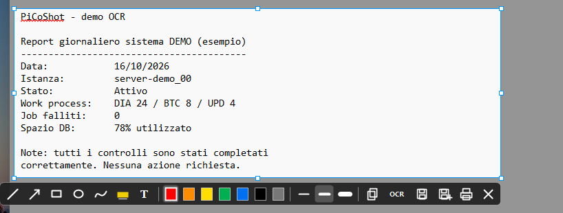
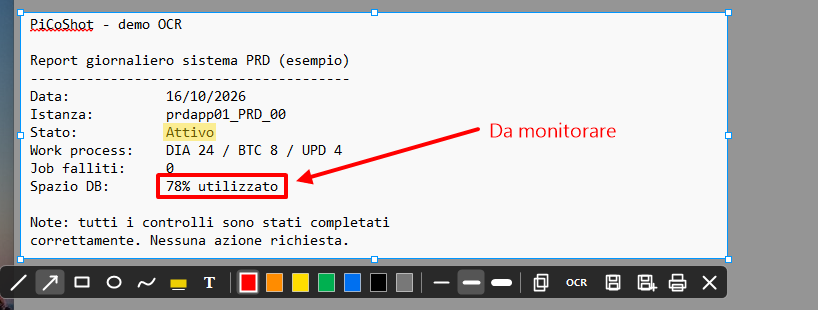
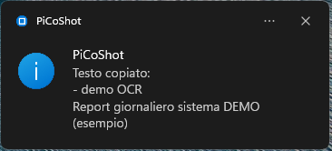

# PiCoShot

Clone "Lightshot-like" portable per Windows: cattura area, annotazioni, salvataggio/copia e OCR offline. Specifiche in [SPEC.md](SPEC.md).

**Versione 0.2.0** · [Change log](CHANGELOG.md)

**Stato:** Fasi 1-5 implementate (cattura, toolbar/salvataggio/stampa, OCR offline, annotazioni, impostazioni). Upload/condivisione online: non previsto (eventuale Fase 6).

## Download

**[Scarica da Microsoft Store](https://apps.microsoft.com/detail/9NTK0XXD2BK0)** (consigliato: si aggiorna da solo) · [Apri nello Store](ms-windows-store://pdp/?productid=9NTK0XXD2BK0)

**[⬇ Scarica lo ZIP portable](https://github.com/picoroma/PiCoShot/releases/latest/download/PiCoShot-portable-x64.zip)** (exe + licenza + istruzioni; [checksum SHA-256](https://github.com/picoroma/PiCoShot/releases/latest/download/PiCoShot-portable-x64.zip.sha256)) · [solo l'exe](https://github.com/picoroma/PiCoShot/releases/latest/download/PiCoShot.exe) · [tutte le versioni](https://github.com/picoroma/PiCoShot/releases)

- Versione portable, nessuna installazione: estrai lo ZIP in una cartella qualsiasi (anche una chiavetta USB) e avvia `PiCoShot.exe`. Compare nell'area di notifica (tray).
- Requisiti: Windows 10 (1903+) o 11 x64; .NET Framework 4.8 è già incluso nel sistema.
- L'exe non è firmato: al primo avvio SmartScreen può mostrare "PC protetto da Windows" → *Ulteriori informazioni* → *Esegui comunque*. In azienda AppLocker o altre policy potrebbero bloccarlo.

## Schermate

**Selezione dell'area con la toolbar**: lo schermo viene congelato e oscurato, l'area scelta resta in chiaro con maniglie di ridimensionamento e dimensioni in pixel.



**Annotazioni al volo**: evidenziatore, riquadro, freccia e testo, inclusi nell'immagine copiata o salvata.



**OCR offline** (`Ctrl+T` o pulsante OCR): il testo dell'area finisce negli appunti e una notifica ne mostra le prime righe.



## Uso
- `Stamp` (o `Ctrl+Shift+S` se Stamp è occupato) → overlay di selezione. `Ctrl+Stamp` → schermo intero già selezionato (quello sotto il cursore). Entrambe le hotkey si cambiano da Impostazioni (quella dello schermo intero si può disattivare).
- Trascina per selezionare; maniglie per ridimensionare, trascina dentro per spostare.
- **✔ OK / `Invio`** eseguono l'azione predefinita (copia immagine, salva PNG, OCR su file `PiCoShot_OCR.txt`, anche tutte insieme: si sceglie nelle Impostazioni; le azioni attive hanno il pallino verde nella barra). **✖** / `Esc` / `Ctrl+X` / clic destro annullano.
- `Ctrl+C` copia solo l'immagine negli appunti.
- `Ctrl+S` salva il PNG nella cartella delle Impostazioni · `Ctrl+Shift+S` salva con nome (PNG/JPG/BMP) · `Ctrl+P` stampa.
- `Ctrl+T` copia negli appunti il testo dell'area (OCR offline di Windows, serve la funzionalità OCR della lingua installata).
- `Ctrl+A` seleziona tutto lo schermo · `Ctrl`+trascinamento copia subito al rilascio.
- Strumenti di annotazione in colonna a destra della selezione (a sinistra/dentro se manca spazio); barra sotto con colori, spessore, azioni e ✔/✖: linea, freccia, riquadro, cerchio, penna, evidenziatore, testo. `Ctrl+Z` annulla l'ultima annotazione; con lo strumento Testo compaiono 4 dimensioni e gli stili grassetto, corsivo ed etichetta su sfondo. `Maiusc` vincola il tratto (l'evidenziatore è dritto, a mano libera con `Maiusc`).
- Impostazioni (menu tray): hotkey (area e schermo intero), cartella screenshot, lingua OCR, colore predefinito delle annotazioni e avvio con Windows. Tutto salvato in `PiCoShot.ini` accanto all'exe (se la cartella non è scrivibile: `%APPDATA%\PiCoShot`).
- **Lingua:** italiano e inglese. Di default segue la lingua di Windows (italiano se è italiano, altrimenti inglese); si cambia da Impostazioni e vale dal riavvio successivo. Il motto nell'About resta in italiano.
- "Avvio con Windows" scrive `HKCU\...\Run` solo se attivato dall'utente (menu tray o Impostazioni) e lo rimuove se disattivato.
- Menu tray → Informazioni su PiCoShot.

## PiCoShot.ini
```ini
[General]
Hotkey=PrintScreen            ; selezione area (es. F3, Ctrl+Shift+S)
HotkeyFullScreen=Ctrl+PrintScreen   ; schermo intero, "None" = disattivata
SaveFolder=%USERPROFILE%\Pictures\PiCoShot
DefaultActions=Copy            ; azioni del ✔ / Invio: Copy,Save,Ocr (anche tutte)
Language=auto                 ; lingua dell'app: auto (come Windows) | it | en
OcrLanguage=auto              ; oppure un tag: it, en-US, ...
AutoStart=false
DefaultColor=#FF0000
```

## Build
Senza .NET SDK (usa il compilatore C# già presente in Windows e il Windows SDK per l'OCR):
```
.\build.ps1
```
Output: `dist\PiCoShot.exe`. Con l'SDK: `dotnet build src\PiCoShot\PiCoShot.csproj -c Release`.

### ZIP portable
```
.\packaging\zip\build-zip.ps1
```
Output: `dist\PiCoShot-portable-x64.zip` e `.sha256` (contiene `PiCoShot.exe`, `LICENSE` e `LEGGIMI.txt` in italiano e inglese).

### Pacchetto MSIX (Microsoft Store)
```
.\packaging\msix\build-msix.ps1 -IdentityName "<da Partner Center>" -Publisher "CN=<da Partner Center>" -PublisherDisplayName "<nome>"
```
Output: `dist\PiCoShot_<versione>_x64.msix` (la versione viene da `Properties\AssemblyInfo.cs`). Bozze di privacy policy e testi della scheda: [docs/store](docs/store).

## Licenza
Il codice sorgente è rilasciato con licenza **GNU General Public License v3.0**: vedi [LICENSE](LICENSE). L'icona e le immagini in `src/PiCoShot/Resources` sono escluse dalla licenza e non vanno riutilizzate senza permesso.
